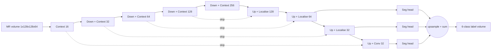
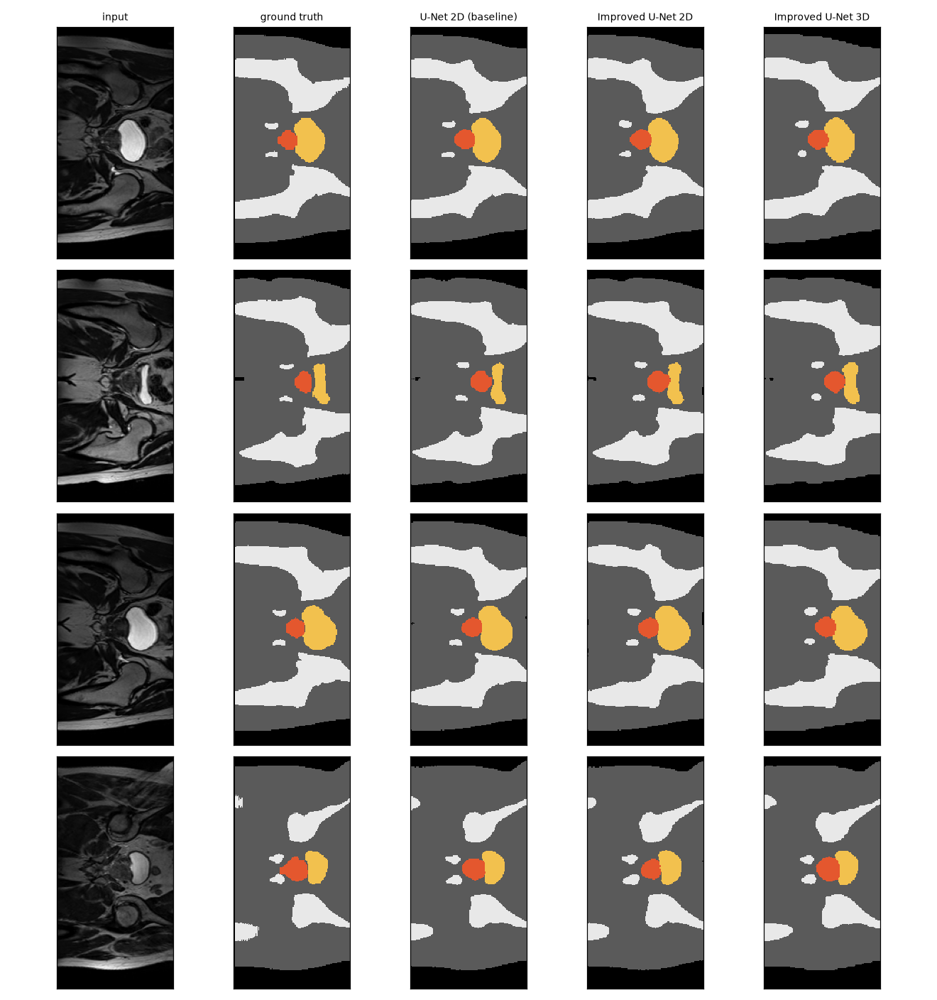
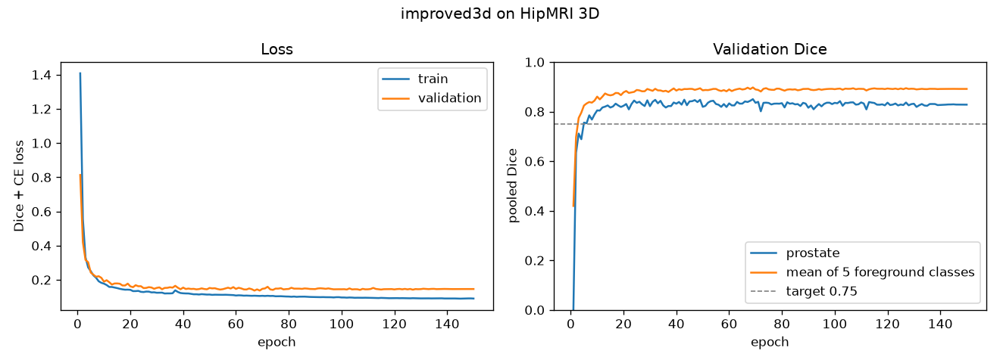
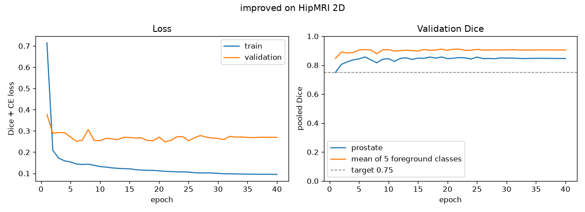
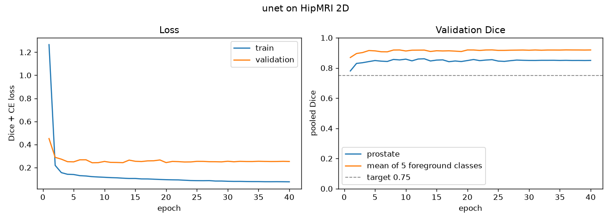
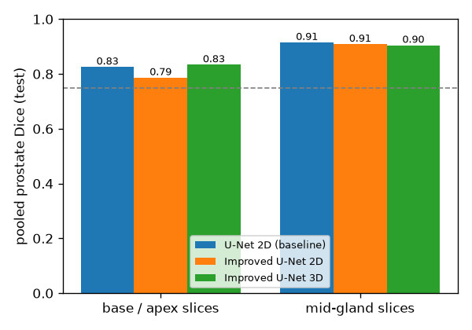
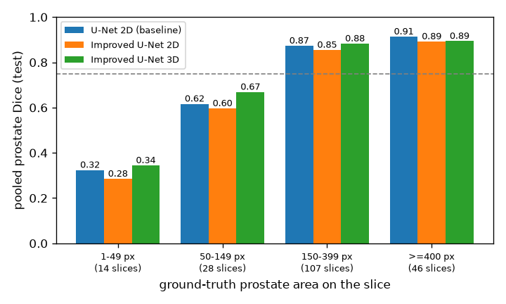
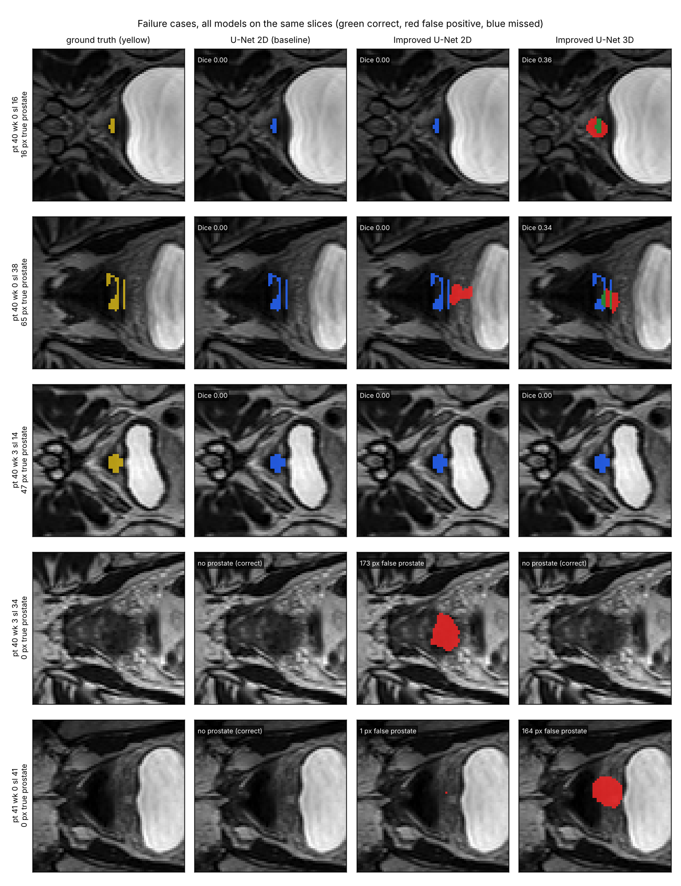

# 3D Improved U-Net for Prostate Segmentation on HipMRI

**COMP3710 Pattern Recognition Report — Sanchit (s4793201)**
Segmentation (Section 2.2) · **3D Improved U-Net** on downsampled HipMRI volumes · Difficulty: **Hard** · Baselines: 2D U-Net and 2D Improved U-Net

### Key findings
- **The 3D Improved U-Net reaches prostate Dice 0.872 ± 0.002** (3 seeds), well above the 0.7 target. It ties the best 2D model overall and is the **best and most stable at the gland tips**.
- **Global Dice hides a failure at the gland tips in every model.** Dice falls from about 0.91 mid-gland to about 0.82 at the base and apex, and to about 0.3 on slices where the prostate is under 50 px.
- **3D context halves the missed tip slices,** but sometimes runs 1–3 slices past the gland's end.
- **Why the 2D Improved U-Net was worse, tested and fixed:** a 15-run ablation (Section 8) switched off its components one at a time and found **instance normalisation** to be the cause. **Swapping it for batch norm fixes it:** the fixed model matches the plain U-Net (0.874 Dice) and runs 40% faster.
- **Recommendation:** use the 3D model, always review the end slices of the gland, and keep only the largest connected prostate region.

### Contents
- [1. Problem and model](#1-problem-and-model)
- [2. Feasibility review (midpoint check-off)](#2-feasibility-review-midpoint-check-off)
- [3. Files and usage](#3-files-and-usage)
- [4. Data and preprocessing](#4-data-and-preprocessing)
- [5. Training](#5-training)
- [6. Results (same 540 test slices, mean ± std over 3 seeds)](#6-results-same-540-test-slices-mean--std-over-3-seeds)
- [7. The dilemma: does global Dice hide boundary failures?](#7-the-dilemma-does-global-dice-hide-boundary-failures)
- [8. Why is the 2D Improved U-Net worse than the plain U-Net? (ablation)](#8-why-is-the-2d-improved-u-net-worse-than-the-plain-u-net-ablation)
- [9. Failure-case autopsy](#9-failure-case-autopsy)
- [10. Recommendation to the project manager](#10-recommendation-to-the-project-manager)
- [11. Artificial Intelligence Usage Disclosure](#11-artificial-intelligence-usage-disclosure)
- [References](#references)

---

## 1. Problem and model

**Problem.** Radiotherapy for prostate cancer needs the prostate, and the bladder and rectum beside it, outlined on every MR slice, which is slow by hand. This project builds an **annotation assistant** that drafts a 6-class label map (background, body, bone, bladder, rectum, prostate) for a specialist to correct. The prostate is only **0.09% of the voxels**, and its tips are tiny and low-contrast.

**Model.** The **Improved U-Net** (Isensee et al., 2018) is an encoder–decoder. The encoder works out *what* is in the scan and the decoder draws *where*, with skip connections carrying fine detail across. It adds three things to a plain U-Net:
- **Residual context modules:** pairs of convolutions with instance norm, leaky ReLU and dropout, added back onto their input.
- **Localisation modules** in the decoder.
- **Deep supervision:** predictions from three decoder levels are summed.

The **same blocks build the 2D and 3D versions** (`modules.py`, `dim=2` or `dim=3`), so 2D vs 3D changes only one thing: whether the model can see the neighbouring slices.




*The same test slices for all models. Body grey, bone white, bladder yellow, rectum blue, prostate red.*

## 2. Feasibility review (midpoint check-off)

The one-page review proposed a **2D Improved U-Net (Normal) vs a 2D U-Net**, with 3D as a stretch goal. **User:** a radiotherapy contouring specialist. **Dilemma:** does good global Dice hide failures at the prostate base and apex?

| # | Acceptance criterion | Final result (3 seeds) |
| --- | --- | --- |
| AC1 | 2D prostate Dice ≥ 0.75 | ✅ 0.851 ± 0.015 |
| AC2 | Improved U-Net beats the 2D U-Net, with base/apex reported | ❌ in 2D (0.851 vs 0.873); explained by the ablation in Section 8. 3D: tie overall, ahead at the tips |
| AC3 | False prostate on ≤ 5% of prostate-free slices | ✅ 2D 1.2%, 3D 0.6% |
| AC4 | ≤ 8 GB VRAM, ≤ 4 h training, ≤ 50 ms per slice | ✅ 2D 0.87 GB, 32 min. 3D 2.6 GB, ≈ 80 min, 58 ms per whole volume |
| AC5 | No patient in two splits | ✅ 31 / 4 / 3 patients, same split for 2D and 3D |
| AC6 (added for 3D) | 3D prostate Dice ≥ 0.7 | ✅ **0.872 ± 0.002** |

**Evidence at the check-off:** 11,460 / 660 / 540 slices from 31 / 4 / 3 patients, zero overlap. The prostate is 0.42% of pixels, which justifies a Dice-based loss, and appears on about 36% of slices. A smoke test fitted in 1.6 GB on an RTX 4060.
**Risks and fallback:** class collapse (Dice + CE loss); undefined Dice on empty slices (false-alarm rate reported instead); only 3 test patients (per-patient Dice reported). The fallback, a region-of-interest crop with class weights, was not needed.
**Addendum (27 Oct):** the 2D results pointed at missing through-plane context, so the project was extended to the planned 3D model. A 3D audit found 211 volumes of 256×256×128 at about 1.6 mm, matching the 2D scans and patients. A 3D smoke test used 2.6 GB.

## 3. Files and usage

| File | Purpose |
| --- | --- |
| `dataset.py` / `dataset3d.py` | 2D slices / 3D volumes: loading, patient-level leakage checks, preprocessing, augmentation |
| `modules.py` | `UNet2D`, `ImprovedUNet2D`, `ImprovedUNet3D`, ablation variants, `DiceCELoss` (pure PyTorch) |
| `train.py` | Train → keep the best validation checkpoint → test once (`--model unet / improved / improved3d / improved_bn …`) |
| `predict.py` / `predict3d.py` | Test metrics and figures; `predict3d.py` scores all models on identical slices |
| `summarise_seeds.py` | Mean ± std over seeds (also for the ablation) |
| `utils.py`, `train_rangpur.slurm`, `requirements.txt` | Metrics and profiling, Rangpur A100 jobs, pinned versions |

```bash
# data (not committed): HipMRI_Study_open/{keras_slices_data, semantic_MRs, semantic_labels_only}
python train.py --model unet       --data-root <study>/keras_slices_data --seed 42 --out runs/unet
python train.py --model improved   --data-root <study>/keras_slices_data --seed 42 --out runs/improved
python train.py --model improved3d --data-root <study> --epochs 150 --batch-size 2 --seed 42 --out runs/improved3d_s42
python predict3d.py --study-root <study> --ckpt3d runs/improved3d_s42/best.pt [more seeds] \
                    --ckpt2d runs/improved/best.pt --baseline2d runs/unet/best.pt
# Rangpur: sbatch --export=ALL,MODEL=improved3d,SEED=42 train_rangpur.slurm
```

### Dependencies
Python 3.13.5, PyTorch 2.14.0 (CUDA 12.6), nibabel 5.4.2, NumPy 2.3.5, Matplotlib 3.11.1, plus SciPy, needed only for the optional largest-component check. Hardware: an RTX 4060 Laptop GPU (8 GB), and Rangpur A100s for the 3D and ablation runs.

```bash
pip install torch==2.14.0 --index-url https://download.pytorch.org/whl/cu126
pip install -r requirements.txt
```

### Reproducibility
- **Fixed seeds:** `--seed` sets Python, NumPy and PyTorch seeds (`utils.set_seed`). Every model was trained with seeds 42, 1 and 2, and results are reported as mean ± std.
- **Fixed splits:** the provided patient-level folders are used unchanged; 3D volumes inherit them, so there is no random split to repeat.
- **Pinned versions:** `requirements.txt`. Every reported number is written to `test_metrics.json` / `comparison3d.json` / `ablation_summary.json` by the scripts, not copied by hand.
- **Expected variation:** mixed precision and non-deterministic cuDNN kernels make reruns differ only in the third decimal. A CPU re-run of the 3D evaluation matched the GPU to within 0.0001.

## 4. Data and preprocessing

- **Patient-level splits (31 / 4 / 3).** Code stops training if any patient appears in two splits. Each 3D volume inherits its patient's 2D split, so **all models are tested once on the same 3 patients (40–42).**
- **The 2D slices are slices of the 3D volumes.** Slice *k* equals `volume[:, 98 + k, :]` flipped, verified pixel for pixel. This lets `predict3d.py` score the 3D model on **exactly the same 540 test slices** as the 2D models.
- **2D:** crop or pad to 256×128, per-slice z-score.
- **3D:** crop or pad to 256×256×128 (the one 144-slice volume is cropped around its prostate), then **downsample ×2 to 128×128×64 (about 3.1 mm)**, with masks downsampled by **majority vote** so thin structures survive. Predictions are upsampled back to full resolution before scoring.
- **Augmentation:** small rotation, scale, shift and intensity changes; no flips.
- **Caveat:** patient 40 supplies 7 of 9 test scans, so per-patient Dice is reported as well.

## 5. Training

AdamW (lr 5×10⁻⁴), 1-epoch warm-up then cosine decay, Dice + cross-entropy, mixed precision, best validation checkpoint kept. **2D:** batch 16, 40 epochs. **3D:** batch 2, 150 epochs.

| 3D Improved U-Net | 2D Improved U-Net | 2D U-Net |
| --- | --- | --- |
|  |  |  |

**All models plateau early** (best epochs: 2D 5–13, 3D 21–69). After that the validation scores stay flat, so best-checkpoint selection prevents overfitting. The dashed line marks 0.75, the 2D target; the 3D target is 0.7.

## 6. Results (same 540 test slices, mean ± std over 3 seeds)

| Test metric | U-Net 2D | Improved U-Net 2D | **Improved U-Net 3D** |
| --- | --- | --- | --- |
| **Prostate Dice** | **0.873 ± 0.008** | 0.851 ± 0.015 | **0.872 ± 0.002** |
| **Prostate Dice at gland tips** (120 slices) | 0.823 ± 0.010 | 0.784 ± 0.029 | **0.830 ± 0.004** |
| Prostate Dice mid-gland (75 slices) | 0.913 ± 0.004 | 0.908 ± 0.005 | 0.909 ± 0.004 |
| Prostate IoU | 0.775 ± 0.012 | 0.741 ± 0.023 | 0.773 ± 0.003 |
| Dice bladder / rectum | 0.966 / 0.851 | 0.964 / 0.856 | 0.959 / 0.844 |
| Dice body / bone | 0.981 / 0.938 | 0.980 / 0.936 | 0.976 / 0.927 |
| False alarms on prostate-free slices | 0.2% | 1.2% | 0.6% |

| Resources (RTX 4060 unless noted) | U-Net 2D | Improved U-Net 2D | Improved U-Net 3D |
| --- | --- | --- | --- |
| Parameters | 7.76 M | 2.78 M | 8.28 M |
| Training VRAM | 0.89 GB | 0.87 GB | 2.60 GB |
| Training time | 35 min | 32 min | 20 min (A100), ≈ 80 min (RTX 4060) |
| Inference | 2.3 ms per slice | 5.2 ms per slice | **58 ms per whole scan** |

**Takeaways**
- **3D ties the best 2D model overall and is 4–7× more stable across seeds.**
- **Against the same architecture in 2D, 3D gains +0.046 at the tips and only +0.001 mid-gland:** the gain is exactly where neighbouring slices should help.
- **3D costs 3× the training memory and about 2.5× the training time,** well under the 5–10× the spec warns of, thanks to downsampling. It segments a whole scan in one pass.

## 7. The dilemma: does global Dice hide boundary failures?

**Yes, in every model. 3D reduces the problem but trades misses for over-runs.**

| Dice at gland tips vs mid-gland | Dice by prostate size on the slice |
| --- | --- |
|  |  |

- **Failures are at the tips.** In both 2D models, every slice with prostate Dice below 0.5 is a tip slice (27/27 and 28/28).
- **Size is the mechanism.** Dice is about 0.9 when the prostate covers 400 px or more, but about 0.3 below 50 px. 3D helps most on small slices, at 0.34 and 0.67 in the two smallest size groups, where it also misses fewer slices (6 vs 11, and 2 vs 7).
- **3D finds the gland ends but sometimes overshoots.** Over the 18 gland ends (9 scans × 2) for seed 42:

| | U-Net 2D | Improved U-Net 2D | Improved U-Net 3D |
| --- | --- | --- | --- |
| Ends exactly right | 5 | 5 | **7** |
| End slices missed | 16 | 14 | **8** |
| Slices past the true end | **0** | 6 | 8 |

- **Resolution is not the limit.** A *perfect* prediction at 3.1 mm would score 0.951 (0.938 at the tips), so most of the 3D model's tip error comes from the network, not the downsampling.
- **Stray islands are rare.** Only 1 of 27 3D predictions had a disconnected prostate blob. Keeping the largest connected region removes it and changes nothing else.

## 8. Why is the 2D Improved U-Net worse than the plain U-Net? (ablation)

**Problem.** The 2D Improved U-Net scored *lower* (0.851 vs 0.873 prostate Dice, 0.784 vs 0.823 at the gland tips) and ran *slower* (5.2 vs 2.3 ms per slice) than the plain U-Net, despite being the more advanced design.

### How we tested it
- **Three suspects, one at a time.** Each is a design choice the Improved U-Net adds over the plain U-Net: (A) spatial **dropout**, (B) **instance normalisation**, (C) **deep supervision**. Each variant switches off exactly one of them; (D) switches off all three.
- **Same everything else:** identical data split, loss, optimiser, schedule and epochs; only the switched-off component differs (`modules.py`, `ABLATIONS`; `train.py --model improved_bn` etc.).
- **3 seeds per variant** so a difference can be told apart from run-to-run noise: 15 training runs in total.
- **A control:** the unchanged Improved U-Net retrained on the same Rangpur A100s, so hardware cannot explain any difference.

### What we found

| Variant (3 seeds each) | Prostate Dice | Dice at gland tips | Worst patient | Latency per slice (A100) |
| --- | --- | --- | --- | --- |
| U-Net 2D (baseline, RTX 4060) | 0.873 ± 0.008 | 0.823 ± 0.010 | 0.865 | not timed on A100 |
| Improved U-Net 2D (control, A100) | 0.859 ± 0.006 | 0.789 ± 0.023 | 0.825 | 5.7 ms |
| A: no dropout | 0.868 ± 0.009 | 0.804 ± 0.009 | 0.843 | 5.6 ms |
| **B: batch norm instead of instance norm** | **0.874 ± 0.001** | **0.821 ± 0.004** | 0.852 | **3.4 ms** |
| C: no deep supervision | 0.866 ± 0.007 | 0.805 ± 0.018 | 0.831 | 5.5 ms |
| D: A + B + C | 0.873 ± 0.007 | 0.823 ± 0.010 | 0.859 | 3.2 ms |

- **Instance normalisation is the cause.** Swapping it for batch norm (B) alone recovers +0.015 prostate Dice and **+0.032 at the gland tips**, exactly matching the plain U-Net, with the smallest spread of any model (± 0.001).
- **Dropout and deep supervision are not the cause.** Removing either (A, C) gives only about +0.01, within seed noise, and removing all three (D) is no better than B alone.
- **Why it happens:** instance norm rescales every slice using *that slice's own* statistics, which erases the absolute contrast separating a tiny prostate tip from its surroundings. Batch norm uses statistics across the batch, so the contrast survives. In 3D each normalisation sees a whole volume, which is consistent with the same blocks working well there.
- **It also explains the speed gap:** instance norm adds per-image work, and batch norm cuts latency from 5.7 to 3.4 ms per slice (both timed on the A100).
- **The control rules out hardware:** 0.859 on the A100 vs 0.851 on the laptop, within noise.

### The fix
**Replace instance normalisation with batch normalisation in the 2D Improved U-Net** (`--model improved_bn`). The fixed model matches the plain U-Net's accuracy (0.874 vs 0.873 overall, 0.821 vs 0.823 at the tips), is the most consistent 2D model, and runs 40% faster than before. The submitted 3D model keeps instance norm, because there it already performs best at the tips.

## 9. Failure-case autopsy



| Row | Case | What happened | Root cause |
| --- | --- | --- | --- |
| 1 | First prostate slice, 16 px | **2D models miss it; 3D finds it** (Dice 0.36) | One tiny slice has no texture cue. The neighbouring slices do, and only 3D sees them |
| 2 | Last slice, a 65 px sliver beside the rectum | Both 2D models miss it, and the Improved U-Net places a false blob next to it; **3D partly finds it** (0.34) | The apex sits on the low-contrast prostate–rectum boundary, the most dangerous place to be wrong |
| 3 | First slice of a tapering tip, 47 px | **All three miss it** | The tip is about one 3D voxel wide at 3.1 mm, so it's hard at every resolution |
| 4 | Two slices past the gland's end | **2D Improved U-Net invents 173 px of prostate**; the others are correct | Over-segmentation carried past the gland. The batch-norm variant (Section 8) made **no** false alarms on any prostate-free slice, on all 3 seeds |
| 5 | One slice past the gland's end | **3D adds 164 px of prostate against the rectum**; the 2D models are correct | 3D context makes the model expect the gland to continue. **This is the 3D model's characteristic error** |

## 10. Recommendation to the project manager

1. **Use the 3D Improved U-Net for drafting.** It ties the best 2D model overall, is best at the tips, misses half as many end slices, and is the most predictable across training runs. It segments a scan in 58 ms.
2. **Always manually review the gland ends.** Flag the last 3 predicted slices plus the 2 slices beyond each end of the gland, and any slice with under 150 px of predicted prostate or prostate touching the rectum. After step 3, on this test set, that window covers every end error of all three models. It was sized on test data, so re-check it on new patients.
3. **Keep only the largest connected prostate region.** It's free, and it removed the only stray island.
4. **If a 2D model is needed, use batch norm, not instance norm,** which is the ablation's fix.
5. **Next experiments:** a loss that penalises over-running the gland, a rectum-overlap penalty, and full-resolution patches around the prostate. Then **test on more patients** before any clinical claim, because 3 test patients can rank models but cannot establish clinical accuracy.

## 11. Artificial Intelligence Usage Disclosure

**Tool:** Claude (Anthropic), through the Claude app, was the only AI tool used. No code-completion tools were used.

**What AI assisted with:** Claude drafted the framework for all code files and helped me complete many of them, it also drafted the audit scripts and this README according to my guidance, and proposed the analyses: the repeated seeds, the like-for-like 2D/3D comparison, the 2D-to-3D slice mapping, the downsampling ceiling, the largest-component check, and the ablation, which followed my tutor's feedback.

**Zero Ai usage for these:**
- **I ran all training myself:** six 2D runs on my GPU, three 3D runs and the 15-run ablation on Rangpur, plus the 2D audit, the smoke tests and the final evaluations. Claude ran some analysis steps through the app's link to my laptop and in its own workspace: the 3D audit, the alignment check, figure generation, a CPU re-run of the 3D evaluation, and the largest-component analysis. I reviewed their outputs.
- **Every number comes from the runs' saved metrics files.** The only exception is the RTX 4060 3D training time, which is extrapolated from measured epoch times and labelled as such.
- **The pipelines were tested on synthetic data with known answers before real data was used.** Bugs found and fixed: dropout attached to the wrong layer, an overlay that darkened the image, a figure that failed on small glands, a loader that would have crashed on the 144-slice volume, and a Rangpur crash caused by a missing package.
- **Checks run in code:** patient leakage, exact 2D/3D alignment, and identical outputs (difference 0.0) after each refactor of the model code.
- **Claims were checked against the outputs, and wrong drafts were corrected:** a review rule that missed a case, an error percentage that was too broad, and a suspected widespread 3D island problem that turned out to be a single case.
- **I read the code, checked the architecture against Isensee et al. (2018), Fig. 1, and am responsible for every line and claim.**

## References

1. O. Ronneberger, P. Fischer and T. Brox, "U-Net: Convolutional networks for biomedical image segmentation," *MICCAI*, 2015. [arXiv:1505.04597](https://arxiv.org/abs/1505.04597)
2. F. Isensee, P. Kickingereder, W. Wick, M. Bendszus and K. H. Maier-Hein, "Brain tumor segmentation and radiomics survival prediction: Contribution to the BRATS 2017 challenge," *Brainlesion*, 2018. [arXiv:1802.10508](https://arxiv.org/abs/1802.10508)
3. Ö. Çiçek, A. Abdulkadir, S. S. Lienkamp, T. Brox and O. Ronneberger, "3D U-Net: Learning dense volumetric segmentation from sparse annotation," *MICCAI*, 2016. [arXiv:1606.06650](https://arxiv.org/abs/1606.06650)
4. COMP3710 / COMP7710 Report Specification v2.5, Appendix B (reading Nifti files), The University of Queensland, 2026.
