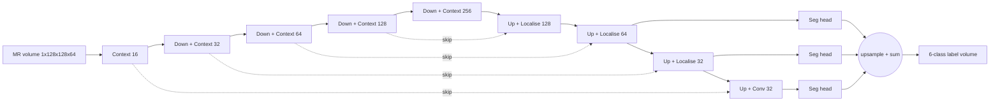
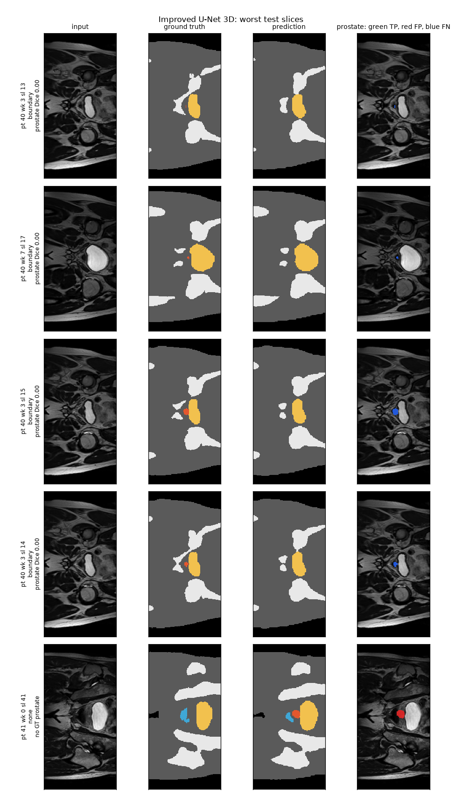
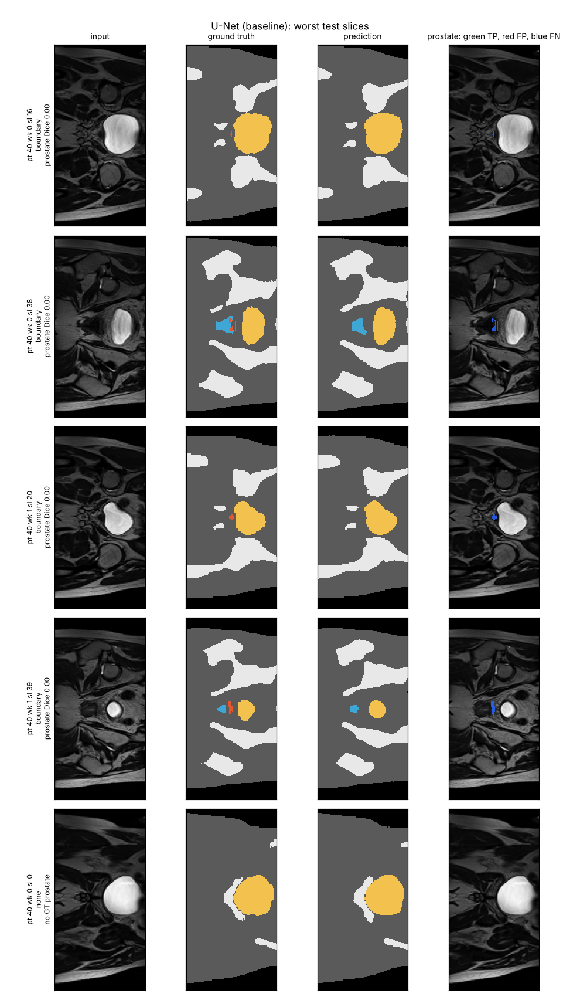
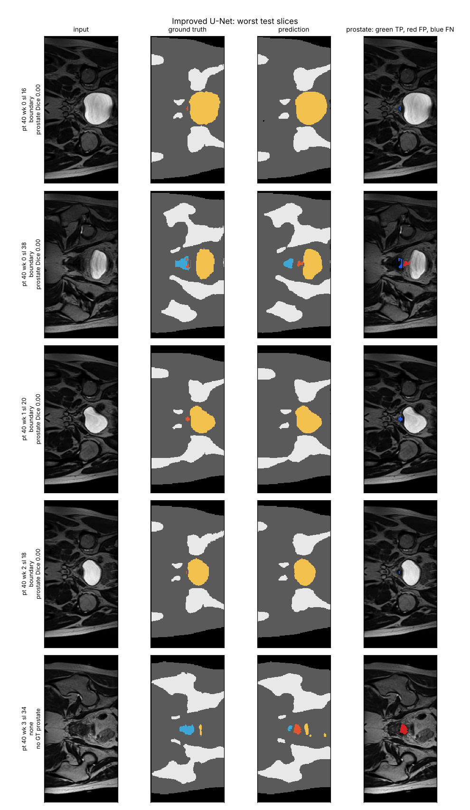

# 3D Improved U-Net for Prostate Segmentation on HipMRI

**COMP3710 Pattern Recognition Report — Sanchit (s4793201)**
Project: Segmentation (Section 2.2) · Model: **3D Improved U-Net** · Dataset: downsampled HipMRI 3D volumes · Difficulty: **Hard** · Baselines: 2D U-Net and 2D Improved U-Net on HipMRI 2D slices

## 1. Problem and algorithm

External-beam radiotherapy for prostate cancer needs the prostate (the target) and nearby organs at risk, the bladder and rectum, contoured on every MR slice. Contouring by hand is slow, so this project builds an **annotation assistant**. It proposes a 6-class label map (background, body, bone, bladder, rectum, prostate) for a pelvic MR scan, and a contouring specialist then reviews and corrects it. The hard part is that the prostate covers only **0.09% of the voxels** in a scan. Its two ends, the base and apex, are small, low-contrast and sit directly against the bladder and rectal wall.

**How it works.** The model is the Improved U-Net of Isensee et al. (2018), used here in 3D on whole volumes. It is an encoder–decoder: the encoder compresses the scan into coarse "what is here" features, and the decoder expands them back to a full label map. Skip connections carry fine "where exactly" detail across from the encoder. Each encoder level is a **pre-activation residual context module**: two 3×3×3 convolutions with instance norm, leaky ReLU and spatial dropout, added back onto their input, which makes the deep network easier to train. Downsampling uses stride-2 convolutions. The decoder uses **localisation modules** (3×3×3 then 1×1×1 convolution) and **deep supervision**: segmentation maps from three decoder scales are upsampled and summed, so coarse layers get a direct training signal. Training minimises soft Dice plus cross-entropy, so the huge body class cannot drown out the tiny prostate.

The difference from the 2D baselines is **through-plane context**. A 2D model segments one slice at a time and cannot see whether the slices above and below contain prostate. A 3D convolution sees all three directions at once. The same `ImprovedUNet` blocks build both the 2D and the 3D model (`modules.py`, `dim=2` or `dim=3`), so the 2D Improved U-Net vs 3D Improved U-Net comparison changes one thing only: the dimensionality.




*The same test slices for all three models: input, ground truth, 2D U-Net, 2D Improved U-Net, 3D Improved U-Net. Colours: body grey, bone white, bladder yellow, rectum blue, prostate red.*

## 2. Feasibility review (midpoint check-off)

The review below is the one-page plan presented at the check-off. It proposed the 2D Improved U-Net (Normal tier), with 3D as a stretch goal. Once the 2D study was complete, the project was extended to the 3D Improved U-Net (Hard tier); the addendum at the end of this section records that change.

**User need.** The user is a radiotherapy contouring specialist (MR physicist or dosimetrist). The prototype drafts prostate, bladder and rectum contours for review. It never replaces their sign-off. The dilemma under test is whether a good global Dice hides failures at the prostate base and apex.

| # | Acceptance criterion | Result (final, 3 seeds per model) |
| --- | --- | --- |
| AC1 | 2D prostate Dice ≥ 0.75 on the held-out test split | **0.851 ± 0.015** (2D Improved U-Net) ✅ |
| AC2 | Improved U-Net beats the 2D U-Net baseline on prostate Dice, with base/apex reported separately | 2D: ❌ 0.851 vs 0.873. 3D: tie overall (0.872 vs 0.873), ahead at base/apex (0.830 vs 0.823) |
| AC3 | False prostate predictions (> 50 px) on ≤ 5% of prostate-free test slices | **1.2%** (2D), **0.6%** (3D) ✅ |
| AC4 | Fits in 8 GB VRAM, trains in ≤ 4 h, infers in ≤ 50 ms per slice | 2D: 0.87 GB, 32 min ✅. 3D: 2.6 GB, ≈ 80 min, 58 ms per whole volume ✅ |
| AC5 | Zero patient overlap between train, validation and test | ✅ (31 / 4 / 3 patients, disjoint, same split for 2D and 3D) |
| AC6 (added with 3D) | 3D prostate Dice ≥ 0.7 on the test split (spec target) | **0.872 ± 0.002** ✅ |

**Model choice.** I chose a 2D Improved U-Net (Normal tier) against a standard 2D U-Net baseline. It builds on encoder–decoder segmentation, residual learning, class-imbalance handling and Dice/IoU evaluation from the course. The architecture and dataset differ from my Lab 2 work (a plain U-Net on OASIS).

**Feasibility evidence** (data audit and GPU smoke test, 24 Oct 2026):

| Check | Result | Implication |
| --- | --- | --- |
| Slices (train / val / test) | 11,460 / 660 / 540; every image has a matching mask | No missing labels |
| Patients (train / val / test) | 31 / 4 / 3, zero overlap | Provided splits are patient-level and kept as-is |
| Slice shape | 256×128 (2 of 200 sampled are 256×144) | Centre-crop/pad to 256×128 |
| Class share | bladder 1.99%, rectum 0.44%, prostate 0.42% of pixels | Dice-based loss needed |
| Slices containing prostate | 36% train, 39% val, 36% test | About 64% of slices are prostate-free |
| GPU smoke test | 7.8 M-param U-Net, batch 16: 1.61 GB, 271 ms per step | Training fits on an RTX 4060 Laptop GPU |

**Risks and fallback.** The tiny prostate class could collapse to background, which Dice + CE and per-epoch prostate tracking guard against. Dice is undefined on empty slices, so I also report a false-alarm rate. The base and apex are the expected failure mode. With only 3 test patients, I report per-patient Dice as well. The fallback was to crop a pelvic region of interest, add augmentation and weight the prostate class. It was not needed.

**Addendum: extension to 3D (27 Oct 2026).** The 2D study (Sections 7–8) showed that every 2D failure sits at the gland ends, where the missing cue is through-plane. That made the planned 3D stretch goal the right next experiment. A 3D audit of all 211 volumes found 256×256×128 voxels at about 1.56 mm (one volume has 144 slices), the same six labels, and the same 211 scans and 38 patients as the 2D data. A 3D smoke test on the laptop GPU (batch 2, 128×128×64) used 2.6 GB and took 30 s per epoch, so training needed no cluster time, although the final runs used Rangpur A100s because the queue was empty.

## 3. Repository layout and usage

| File | Purpose |
| --- | --- |
| `dataset.py` | 2D: Nifti loading, patient-disjoint split check, crop/pad, z-score, `.npz` cache, GPU augmentation, base/apex slice labelling |
| `dataset3d.py` | 3D: volume loading, 2D-consistent patient splits, ×2 downsampling with majority-vote masks, crop of the 144-slice volume, cache, 3D augmentation |
| `modules.py` | `UNet2D` (baseline), `ImprovedUNet2D`, `ImprovedUNet3D` (same blocks, `dim=2/3`), `DiceCELoss` — pure PyTorch |
| `utils.py` | Dice/IoU from pixel counts (2D or 3D), evaluation loop, latency/VRAM profiling, training curves |
| `train.py` | Trains, validates, keeps the best validation prostate Dice, then tests once (`--model unet / improved / improved3d`) |
| `predict.py` | 2D models: test metrics, failure figures, size / error-type / gland-extent analyses |
| `predict3d.py` | 3D model: scores it on the exact same 540 test slices as the 2D models, downsampling ceiling, 3-model figures |
| `summarise_seeds.py` | Mean ± std of 2D test metrics over seeds |
| `train_rangpur.slurm` | Any of the three models on a Rangpur A100 |
| `requirements.txt` | Pinned package versions |

```bash
# data (not committed): copy HipMRI_Study_open/{keras_slices_data, semantic_MRs, semantic_labels_only} from Rangpur
# 2D baselines (about 32-35 min each on an RTX 4060 Laptop GPU), seeds 42 / 1 / 2
python train.py --model unet     --data-root <study>/keras_slices_data --seed 42 --out runs/unet
python train.py --model improved --data-root <study>/keras_slices_data --seed 42 --out runs/improved
# 3D model (about 20 min on an A100, about 80 min on an RTX 4060), seeds 42 / 1 / 2
python train.py --model improved3d --data-root <study> --epochs 150 --batch-size 2 --seed 42 --out runs/improved3d_s42
#   or on Rangpur:  sbatch --job-name=hipmri3d --export=ALL,MODEL=improved3d,SEED=42 train_rangpur.slurm
# evaluation and figures (writes figures/)
python predict.py   --data-root <study>/keras_slices_data --ckpt runs/improved/best.pt --baseline runs/unet/best.pt
python summarise_seeds.py --runs runs/improved runs/improved_s1 runs/improved_s2 runs/unet runs/unet_s1 runs/unet_s2
python predict3d.py --study-root <study> --ckpt3d runs/improved3d_s42/best.pt runs/improved3d_s1/best.pt runs/improved3d_s2/best.pt \
                    --ckpt2d runs/improved/best.pt --baseline2d runs/unet/best.pt
```

**Dependencies.** These are the versions all results were produced with (Windows 11, NVIDIA RTX 4060 Laptop GPU with 8 GB, plus Rangpur NVIDIA A100-PCIE-40GB for the 3D runs). They are also pinned in `requirements.txt`.

| Package | Version |
| --- | --- |
| Python | 3.13.5 |
| PyTorch | 2.14.0 (CUDA 12.6 build) |
| nibabel | 5.4.2 |
| NumPy | 2.3.5 |
| Matplotlib | 3.11.1 |
| SciPy | only for the optional largest-component check in `predict3d.py` |

```bash
pip install torch==2.14.0 --index-url https://download.pytorch.org/whl/cu126
pip install -r requirements.txt
```

**Reproducibility.** Seeds are fixed for Python, NumPy and PyTorch, and every model was trained with seeds 42, 1 and 2. All three models share the same patient split and the same Dice + CE loss and optimiser. Mixed precision and non-deterministic cuDNN kernels mean reruns can differ in the third decimal place. As a check, the 3D evaluation was re-run independently on a CPU and reproduced the GPU test numbers to within 0.0001.

## 4. Data, preprocessing and splits

- **Splits.** The provided 2D `train / validate / test` folders are **patient-disjoint** (31 / 4 / 3 patients). `assert_patient_disjoint` aborts training on any overlap. Every 3D volume inherits its patient's 2D split (`dataset3d.patient_split_map`), so all three models are trained on the same 31 patients, selected on the same 4 and tested **once** on the same 3 (patients 40–42). Splitting slices or scans at random would put near-identical neighbouring slices, or repeat scans of one patient, on both sides and inflate Dice.
- **The 2D data are slices of the 3D data.** I checked this pixel by pixel: 2D slice *k* of a scan is exactly `volume[:, 98 + k, :]`, flipped along the first axis. The 2D set is the central 60 slices along that axis. `predict3d.py` uses this to read the 3D model's output out on exactly the same 540 test slices the 2D models are scored on, and it stops if the alignment fails on any scan.
- **2D preprocessing.** Images and masks are cropped or padded together to 256×128. Each slice is z-score normalised (Appendix B of the spec).
- **3D preprocessing.** Volumes are cropped or padded to 256×256×128. The one 144-slice volume is cropped around its prostate, so no gland voxel is lost. Each volume is then downsampled ×2 per axis to **128×128×64 (about 3.1 mm voxels)**, which is the spec's "downsampled HipMRI 3D" and makes training fit easily in 8 GB. Images use 2×2×2 average pooling. Masks use a **majority vote** over each 2×2×2 block, because plain stride-2 subsampling deletes thin structures. In a unit test, a 1-voxel-thick sheet survived majority voting (16 voxels) but vanished under subsampling (0 voxels). In-plane voxel size varies between scans (1.41–1.88 mm, mostly 1.68 mm) and is not resampled, matching how the 2D slices were made.
- **3D evaluation at full resolution.** The 3D model predicts at 128×128×64. Its class probabilities are trilinearly upsampled to 256×256×128 before argmax, so it is scored on the original label grid like the 2D models.
- **Augmentation** (training only, on the GPU): ±10° rotation (in-plane only for 3D), 0.9–1.1 scale, ±5% shift (bilinear for images, nearest neighbour for masks), and ±10% intensity gain and shift. There are no flips, so anatomical orientation stays fixed.
- **Test-set composition.** Patient 40 was scanned at 7 time points, so it contributes 7 of the 9 test scans and 141 of the 195 test slices that contain prostate. Pooled test metrics lean heavily on one patient, so per-patient Dice is reported too.

## 5. Training

All models use AdamW (lr 5×10⁻⁴, weight decay 10⁻⁵), a 1-epoch linear warm-up then cosine decay, and mixed precision. The checkpoint with the best **validation** prostate Dice is kept. 2D models use batch 16 for 40 epochs (716 steps per epoch). The 3D model uses batch 2 for 150 epochs (95 steps per epoch, 14,250 steps in total, about half the 2D step count).

| 3D Improved U-Net (seed 42) | 2D Improved U-Net (seed 42) | 2D U-Net (seed 42) |
| --- | --- | --- |
|  |  |  |

The 2D models peak early: their best validation epochs are 5–13, and after that training loss keeps falling while validation loss stays flat. They start fitting the 31 training patients more closely without generalising better, and best-checkpoint selection protects against this. The 3D model's best epochs were 69, 43 and 21, and its validation Dice plateaus around 0.83–0.85 from about epoch 20. So 150 epochs was more than needed, but cost nothing at 8 s per epoch on an A100. The dashed line on the curves marks 0.75, the 2D target; the 3D target is 0.7. Validation has only 4 patients, so epoch-to-epoch swings of ±0.02 are noise.

## 6. Results on the held-out test split (3 patients, 9 scans, 540 slices)

All three models are scored on **the same 540 full-resolution test slices**. Values are mean ± sample standard deviation over 3 seeds. Dice and IoU are pooled over all test pixels.

| Test metric | U-Net 2D (baseline) | Improved U-Net 2D | **Improved U-Net 3D** |
| --- | --- | --- | --- |
| Dice body | 0.981 ± 0.001 | 0.980 ± 0.000 | 0.976 ± 0.001 |
| Dice bone | 0.938 ± 0.002 | 0.936 ± 0.001 | 0.927 ± 0.006 |
| Dice bladder | 0.966 ± 0.001 | 0.964 ± 0.002 | 0.959 ± 0.001 |
| Dice rectum | 0.851 ± 0.006 | 0.856 ± 0.011 | 0.844 ± 0.016 |
| **Dice prostate** | **0.873 ± 0.008** | 0.851 ± 0.015 | **0.872 ± 0.002** |
| IoU prostate | 0.775 ± 0.012 | 0.741 ± 0.023 | 0.773 ± 0.003 |
| Prostate Dice, base/apex slices (120) | 0.823 ± 0.010 | 0.784 ± 0.029 | **0.830 ± 0.004** |
| Prostate Dice, mid-gland slices (75) | **0.913 ± 0.004** | 0.908 ± 0.005 | 0.909 ± 0.004 |
| False-alarm rate on 345 prostate-free slices | 0.2 ± 0.3% | 1.2 ± 0.3% | 0.6 ± 0.5% |
| Worst-patient prostate Dice | 0.865 ± 0.009 | 0.834 ± 0.003 | 0.857 ± 0.010 |

The 3D model clears the spec's 3D target (Dice ≥ 0.7) by a wide margin on every seed (0.870 / 0.873 / 0.873). Its volumetric prostate Dice on the full 256×256×128 grid is identical, at 0.872 ± 0.002.

**Resource profile.** Latency and inference VRAM were measured on the RTX 4060 in one session, with batch 1.

| Resource | U-Net 2D | Improved U-Net 2D | Improved U-Net 3D |
| --- | --- | --- | --- |
| Parameters | 7.76 M | **2.78 M** | 8.28 M |
| Training peak VRAM | 0.89 GB | 0.87 GB | 2.60 GB (3×) |
| Training time | 34.7 ± 0.7 min (RTX 4060) | 32.0 ± 0.6 min (RTX 4060) | 20.1 min (A100); ≈ 80 min on the RTX 4060 (30–37 s per epoch measured) |
| Inference latency | 2.3 ms per slice | 5.2 ms per slice | **58 ms per whole volume** |
| Inference for one scan's 60 slices | 136 ms | 309 ms | 58 ms (the whole volume at once) |
| Inference peak VRAM | 56 MB | 24 MB | 631 MB |

The 2D baselines and the 3D model tie on overall prostate Dice (0.873 vs 0.872). The 3D model is **7× more stable across seeds** (± 0.002 vs ± 0.015 for the 2D Improved U-Net) and is the best model at the gland ends. Against the same architecture in 2D, 3D adds +0.021 on prostate overall, +0.046 at base/apex and only +0.001 mid-gland. It is slightly behind on the large organs (0.5–1.1 points), which is what the coarser 3.1 mm grid costs on their boundaries. 3D costs 3× the training memory and about 2.5× the training time of 2D on the same GPU, which is well below the 5–10× the spec warns of, because the volumes are downsampled. A whole scan is also faster to segment in 3D, because one forward pass replaces 60.

## 7. Open research dilemma: does 3D context fix the boundary failures that global Dice hides?

**Partly. Global Dice hides a large failure at the ends of the gland in every model. 3D context reduces how often the gland ends are missed, but trades some of those misses for over-runs, and resolution is not what limits it.**

| Dice by slice position | Dice by prostate area on the slice |
| --- | --- |
|  |  |

1. **The hidden failure (all models).** Prostate Dice drops by 0.08–0.12 from mid-gland to base/apex slices. A slice counts as base/apex if it lies in the outer thirds of its scan's prostate-containing slices. In both 2D models, **every** test slice with prostate Dice below 0.5 is a base/apex slice (27 of 27 and 28 of 28).
2. **Size is the mechanism.** Where the true prostate covers 400 or more pixels, every model reaches about 0.9. Below 50 px, Dice falls to about 0.3. The gland is cone-shaped, so its first and last slices are exactly where the cross-section is smallest. 3D helps most where 2D is weakest:

| True prostate area on the slice | U-Net 2D | Improved U-Net 2D | Improved U-Net 3D |
| --- | --- | --- | --- |
| 1–49 px (14 slices) | 0.32, 11 missed | 0.28, 10 missed | **0.34, 6 missed** |
| 50–149 px (28 slices) | 0.62, 7 missed | 0.60, 4 missed | **0.67, 2 missed** |
| 150–399 px (107 slices) | 0.87 | 0.85 | **0.88** |
| ≥ 400 px (46 slices) | **0.91** | 0.89 | 0.89 |

3. **Controlled test of spatial context.** The 2D and 3D Improved U-Nets differ only in dimensionality. Adding the third dimension raised base/apex Dice from 0.784 to 0.830 (+0.046) while mid-gland stayed flat (0.908 to 0.909). The gain is concentrated exactly where through-plane context should matter, and seed-to-seed spread at the boundary fell from ± 0.029 to ± 0.004. The extra in-plane context of the 2D Improved U-Net, by contrast, did not help the boundary: it was 4 points worse than the plain 2D U-Net there.
4. **Gland extent: 3D finds the ends but overshoots some of them.** Comparing each scan's true range of prostate slices with the predicted range (seed 42, 9 scans, so 18 gland ends):

| | U-Net 2D | Improved U-Net 2D | Improved U-Net 3D |
| --- | --- | --- | --- |
| Gland ends predicted exactly | 5 of 18 | 5 of 18 | **7 of 18** |
| End slices missed (under-contour) | 16 | 14 | **8** |
| Slices predicted past the true end (over-run) | **0** | 6 (3 ends: 1, 2, 3 slices) | 8 (5 ends: 1, 1, 1, 2, 3 slices) |

The 3D model halves the missed end slices (16 to 8) and has the most exact ends. But it over-runs 5 of the 18 ends, mostly by a single slice, while the 2D U-Net never over-runs. The pixel counts show the same trade: 3D misses 38% fewer prostate pixels than the 2D U-Net (4,694 vs 7,546) but adds 62% more false-positive ones (11,904 vs 7,357), almost all of them on surrounding *body* tissue. One 3D voxel spans two full-resolution slices, so a one-slice over-run is half a voxel and partly a resolution artefact. The 2- and 3-slice over-runs are real errors.

5. **Resolution is not the bottleneck.** A *perfect* prediction at the downsampled 3.1 mm resolution, upsampled and scored the same way (`downsampling_ceiling` in `figures/comparison3d.json`), reaches prostate Dice 0.951: 0.938 at base/apex and 0.964 mid-gland. The trained 3D model is 0.11 below that ceiling at base/apex and 0.05 below it mid-gland. So most of its boundary error is the network's, not the downsampling's. Better 3D training, not a finer grid, is the next lever.
6. **Disconnected artefacts are rare in 3D.** Only one of the 27 seed-and-scan predictions contained a stray prostate island away from the gland (seed 1, scan 40/wk 3, out to slice 59). Keeping the largest connected prostate region removes it at no cost, with no effect anywhere else. This is a post-hoc check (`predict3d.py`, "+ largest component") and was not used to select models.
7. **Rectal leakage.** False prostate on rectum: 2D U-Net 19 px, 2D Improved U-Net 293 px, 3D 73 ± 48 px across seeds. 3D is far safer than the 2D Improved U-Net but not as conservative as the plain 2D U-Net.

**Why the 2D Improved U-Net underperformed (hypotheses, not tested):** (a) its dropout 0.3 and instance-norm settings were tuned for 3D brain-tumour volumes, and may over-regularise small 2D slices; (b) summing upsampled coarse segmentation maps (deep supervision) can produce blob-like false positives, which matches its extra false alarms; (c) instance normalisation removes each slice's absolute contrast, which may weaken the faint cue separating the apex from the rectal wall. That the *same* blocks work well in 3D, where each instance-norm call sees a whole volume, is consistent with (a) and (c).

## 8. Failure-case autopsy

Each figure shows input · ground truth · prediction · prostate error overlay, with green = correct, red = false positive and blue = missed.

| 3D Improved U-Net | U-Net 2D | Improved U-Net 2D |
| --- | --- | --- |
|  |  |  |

| # | Slice (patient, week, slice) | What happened | Root cause |
| --- | --- | --- | --- |
| 1 | 40, wk 0, slice 16: **first** prostate slice | A 16 px speck against a large, bright, full bladder. Both 2D models predict none of it; the 3D model starts its gland exactly here (predicted range 16–39). | Partial-volume effect at the bladder neck. One slice gives no texture cue; the neighbouring slices do, which is what 3D adds. |
| 2 | 40, wk 0, slice 38: **last** prostate slice | A 65 px sliver between rectum and bladder. The 2D U-Net misses it, assigning part to rectum; the 2D Improved U-Net predicts 71 px, all in the wrong place. | The apex sits on the low-contrast prostate–rectum interface, the clinically most dangerous place to be wrong. |
| 3 | 40, wk 3, slices 13–15: the first three prostate slices | All three models miss them. The 3D model's gland starts at slice 16, a 3-slice under-run, its largest. | The gland tapers into a few-pixel tip over three slices. At 3.1 mm a 3D voxel spans two of them, so the tip is a single, partly filled voxel. |
| 4 | 40, wk 3, slice 34: **no prostate**, two slices past the gland's end (32) | The 2D Improved U-Net places 173 px of prostate here, 147 of them on the rectum. The 3D model over-runs by one slice (to 33); the 2D U-Net stops at the true end. | Over-segmentation carried past the end of the gland into the rectum: the proctitis risk the spec names. |
| 5 | 41, wk 0, slice 41: **no prostate**, one slice past the gland's end (40) | The 3D model (seed 42) continues the prostate 3 slices past the true end (to 43), in contact with the rectum. | 3D context makes the model confident that the gland continues; at the apex it extrapolates the gland's shape too far. This is the 3D model's characteristic error. |

Common thread: every failure is at, or just beyond, the superior or inferior end of the gland. 2D models mostly stop short; the 3D model mostly gets the ends right but sometimes runs one to three slices too far. Without orientation metadata I cannot say reliably which end of the slice index is base and which is apex, so the cases are labelled "first" and "last".

## 9. Recommendation to the project manager

1. **Adopt the 3D Improved U-Net as the drafting model, with mandatory end-slice review.** It ties the best 2D model on overall prostate Dice (0.872 vs 0.873), is the best at the gland ends (0.830), misses half as many end slices and is 4–7× more stable across training runs. That predictability matters for a clinical tool. It segments a whole scan in 58 ms on a laptop GPU.
2. **Do not deploy the 2D Improved U-Net.** It is worst at the boundary and leaks the most onto the rectum (293 px).
3. **Never auto-accept the ends of the gland, whatever the model.** At each end of the predicted prostate stack, flag the last 3 predicted slices and the 2 slices beyond them for full manual contouring, plus any slice where the predicted prostate is under 150 px or touches the rectum. On this test set, after the largest-component step (point 4), that window covers every gland-end error of all three models (misses of up to 3 slices, over-runs of up to 3). It was sized on the test set, so it must be re-checked on new patients.
4. **Add the free post-processing step.** Keep only the largest connected prostate region in 3D. It removed the one stray island in 27 predictions and changed nothing else.
5. **Next experiment: improve 3D training, not resolution.** The 3D model sits 0.11 below the downsampling ceiling at the gland ends, so a finer grid alone would not fix the boundary. Worth trying, in order: a boundary-aware loss, or one that penalises over-runs, to counter the 3D model's over-extension at the apex; a rectum-overlap penalty; and full-resolution patch training around the prostate.
6. **Get a larger test cohort before any clinical claim.** Three test patients, one of whom supplies 72% of the prostate slices, are enough to rank the models but not to quote clinical accuracy.

## 10. Artificial Intelligence Usage Disclosure

**Tools used.** Claude (Anthropic) was the only AI tool used, through the Claude app. No code-completion tools (such as Copilot) were used.

**What AI assisted with.** Claude did a large share of this project, and I want to state that plainly:
- **Planning:** scoping the project and difficulty tier, drafting the one-page feasibility review, and writing the 2D and 3D data-audit scripts whose results appear in Section 2.
- **Code:** first drafts of every file in this folder (`dataset.py`, `dataset3d.py`, `modules.py`, `utils.py`, `train.py`, `predict.py`, `predict3d.py`, `summarise_seeds.py`, `train_rangpur.slurm`), plus later additions such as the size, error-type, gland-extent, downsampling-ceiling and largest-component analyses.
- **Analysis and writing:** suggesting the repeated-seed experiment and the like-for-like 2D/3D comparison on identical slices, finding the 2D-to-3D slice mapping, computing the statistics, and drafting this README, including the interpretation of results, the failure autopsy and the recommendation.

**What I did, and how the AI output was audited and tested.**
- I ran every training run myself: all six 2D runs on my own GPU and the three 3D runs on Rangpur, plus the 2D data audit, the smoke tests and the final `predict3d.py` evaluation. Some analysis steps were run by Claude, through the app's link to my laptop and in its own cloud workspace: the 3D data audit, the 2D-to-3D slice-alignment check, the 2D figure generation, an independent CPU re-run of the 3D evaluation, and the largest-component analysis. I reviewed their outputs. Every number in this report comes from the logs and the `test_metrics.json`, `comparison.json` and `comparison3d.json` files these runs wrote. None is estimated or typed in by hand, except the RTX 4060 3D training time, which is extrapolated from measured epoch times and labelled as such.
- Before any real data was used, the full 2D and 3D pipelines were run end to end on synthetic data with known answers. Both models reached Dice 0.97–1.0 on it. A "perfect model" test of the 3D upsampling and slice read-out reproduced the expected resolution ceiling. These tests exposed bugs that were fixed: dropout attached to the wrong layer, an error overlay that darkened the whole image, a figure that failed on small glands, and a loader that would have crashed on the one 144-slice volume. A first Rangpur 3D run also crashed (matplotlib missing on the cluster) and was rerun.
- Correctness checks run in code, not by assumption: `assert_patient_disjoint` and `list_volumes` stop on any patient leakage. `predict3d.py` stops if the 2D/3D slice alignment is not exact. The refactored 2D Improved U-Net was confirmed to give identical outputs (maximum difference 0.0) to the version the 2D results were produced with.
- I read through all of the code and checked `ImprovedUNet` against Fig. 1 of Isensee et al. (2018): context modules, stride-2 downsampling, localisation modules and three-scale deep supervision.
- Claims in the README were checked against the outputs. Drafted claims that turned out to be wrong were corrected before submission: a proposed review rule would not have caught one autopsy case, an error-type percentage was too broad, and a suspected widespread 3D "disconnected island" problem turned out to be a single case.
- I am responsible for every line of code and every claim in this submission, and I can explain and defend each design decision.

## References

1. O. Ronneberger, P. Fischer and T. Brox, "U-Net: Convolutional networks for biomedical image segmentation," *MICCAI*, 2015, pp. 234–241.
2. F. Isensee, P. Kickingereder, W. Wick, M. Bendszus and K. H. Maier-Hein, "Brain tumor segmentation and radiomics survival prediction: Contribution to the BRATS 2017 challenge," *Brainlesion: Glioma, Multiple Sclerosis, Stroke and Traumatic Brain Injuries*, 2018, pp. 287–297.
3. Ö. Çiçek, A. Abdulkadir, S. S. Lienkamp, T. Brox and O. Ronneberger, "3D U-Net: Learning dense volumetric segmentation from sparse annotation," *MICCAI*, 2016, pp. 424–432.
4. COMP3710 / COMP7710 Report Specification v2.5, Appendix B (reading Nifti files), The University of Queensland, 2026.
