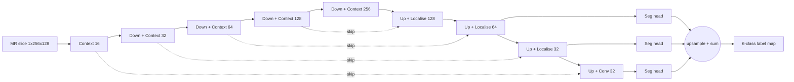
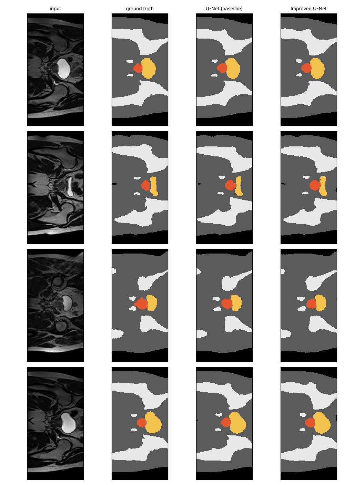
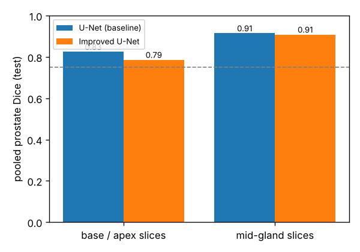
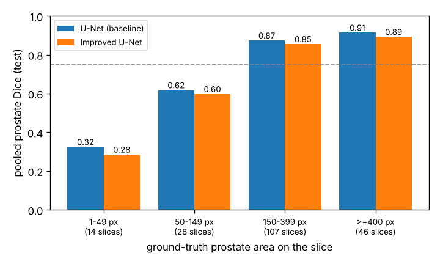

# 2D Improved U-Net for Prostate Segmentation on HipMRI

**COMP3710 Pattern Recognition Report — Sanchit (s4793201)**
Project: Segmentation (Section 2.2) · Model: 2D Improved U-Net · Dataset: HipMRI 2D slices · Difficulty: **Normal**

## 1. Problem and algorithm

External-beam radiotherapy for prostate cancer needs the prostate (the target) and nearby organs at risk, the bladder and rectum, contoured on every MR slice. Contouring by hand is slow, so this project builds an **annotation assistant**. It proposes a 6-class label map (background, body, bone, bladder, rectum, prostate) for each 2D axial slice of the HipMRI study. A contouring specialist then reviews and corrects it. The hard part is that the prostate covers only **0.42% of pixels** and appears on only about 36% of slices. Its superior (base) and inferior (apex) ends are small and have low contrast.

**How it works.** The model is a 2D adaptation of the Improved U-Net of Isensee et al. (2018). It is an encoder–decoder: the encoder compresses the slice into coarse "what is here" features, and the decoder expands them back to a full-resolution label map. Skip connections carry fine "where exactly" detail across from the encoder. Compared with the original U-Net, each encoder level is a **pre-activation residual context module**. That is two 3×3 convolutions with instance norm, leaky ReLU and spatial dropout, added back onto their input, which makes the deep network easier to train. Downsampling uses stride-2 convolutions instead of max pooling. The decoder uses **localisation modules** (3×3 then 1×1 convolution) and **deep supervision**: segmentation maps from three decoder scales are upsampled and summed, so coarse layers also receive a direct training signal. Training minimises soft Dice plus cross-entropy. The Dice term stops the huge body class from dominating the tiny prostate.




*Typical test slices: input, ground truth, baseline U-Net and Improved U-Net. Colours: body grey, bone white, bladder yellow, rectum blue, prostate red.*

## 2. Feasibility review (midpoint check-off)

**User need.** The user is a radiotherapy contouring specialist (MR physicist or dosimetrist). The prototype drafts prostate, bladder and rectum contours for review. It never replaces their sign-off. The dilemma under test is whether a good global Dice hides failures at the prostate base and apex.

| # | Acceptance criterion | Result |
| --- | --- | --- |
| AC1 | Prostate Dice ≥ 0.75 on the held-out test split | **0.851 ± 0.015** over 3 seeds ✅ |
| AC2 | Improved U-Net beats the 2D U-Net baseline on prostate Dice, with base/apex reported separately | ❌ **Not met**: baseline 0.873 ± 0.008 vs 0.851 ± 0.015 over 3 seeds (Section 6) |
| AC3 | False prostate predictions (> 50 px) on ≤ 5% of prostate-free test slices | **1.2 ± 0.3%** ✅ |
| AC4 | Fits in 8 GB VRAM, trains in ≤ 4 h, infers in ≤ 50 ms per slice | **0.87 GB, 32 min, 6.9 ms** ✅ |
| AC5 | Zero patient overlap between train, validation and test | ✅ (31 / 4 / 3 patients, disjoint) |

**Model choice.** I chose a 2D Improved U-Net (Normal tier) against a standard 2D U-Net baseline. It builds on encoder–decoder segmentation, residual learning, class-imbalance handling and Dice/IoU evaluation from the course. The architecture and dataset differ from my Lab 2 work (a plain U-Net on OASIS).

**Feasibility evidence** (data audit and GPU smoke test, 24 Oct 2026):

| Check | Result | Implication |
| --- | --- | --- |
| Slices (train / val / test) | 11,460 / 660 / 540; every image has a matching mask | No missing labels |
| Patients (train / val / test) | 31 / 4 / 3, zero overlap | Provided splits are patient-level and kept as-is |
| Slice shape | 256×128 (2 of 200 sampled are 256×144) | Centre-crop/pad to 256×128 |
| Class share | bladder 1.99%, rectum 0.44%, prostate 0.42% of pixels | Dice-based loss needed |
| Slices containing prostate | 36% train, 39% val, 36% test | About 64% of slices are prostate-free |
| GPU smoke test | 7.8 M-param U-Net, batch 16: 1.61 GB, 271 ms per step | Training fits on an RTX 4060 Laptop GPU |

**Risks and fallback.** The tiny prostate class could collapse to background, which Dice + CE and per-epoch prostate tracking guard against. Dice is undefined on empty slices, so I also report a false-alarm rate. The base and apex are the expected failure mode. With only 3 test patients, I report per-patient Dice as well. The fallback was to crop a pelvic region of interest, add augmentation and weight the prostate class. It was not needed.

## 3. Repository layout and usage

| File | Purpose |
| --- | --- |
| `dataset.py` | Nifti loading, patient-disjoint split check, crop/pad, z-score, `.npz` cache, GPU augmentation, base/apex slice labelling |
| `modules.py` | `UNet2D` (baseline), `ImprovedUNet2D` (proposed), `DiceCELoss` — pure PyTorch |
| `utils.py` | Dice/IoU from pixel counts, evaluation loop, latency/VRAM profiling, training curves |
| `train.py` | Trains, validates, checkpoints the best validation prostate Dice, then tests once |
| `predict.py` | Loads trained weights, reports test metrics for both models, writes the figures used here |
| `summarise_seeds.py` | Mean ± std of test metrics over repeated runs with different seeds |
| `train_rangpur.slurm` | Same training on a Rangpur A100 (`sbatch --export=MODEL=improved train_rangpur.slurm`) |

```bash
# 1. data: copy HipMRI_Study_open/keras_slices_data from Rangpur (not committed to git)
# 2. train both models on identical splits (about 32 and 35 min on an RTX 4060 Laptop GPU)
python train.py --model improved --data-root <path>/keras_slices_data
python train.py --model unet     --data-root <path>/keras_slices_data
# 3. evaluate, compare and draw figures (writes figures/)
python predict.py --data-root <path>/keras_slices_data --ckpt runs/improved/best.pt --baseline runs/unet/best.pt
# 4. optional: repeat step 2 with --seed 1 / --seed 2 --out runs/<model>_s<seed>, then
python summarise_seeds.py --runs runs/improved runs/improved_s1 runs/improved_s2 runs/unet runs/unet_s1 runs/unet_s2
```

**Dependencies.** These are the versions all results were produced with (Windows 11, NVIDIA RTX 4060 Laptop GPU, 8 GB). They are also pinned in `requirements.txt`.

| Package | Version |
| --- | --- |
| Python | 3.13.5 |
| PyTorch | 2.14.0 (CUDA 12.6 build) |
| nibabel | 5.4.2 |
| NumPy | 2.3.5 |
| Matplotlib | 3.11.1 |

```bash
pip install torch==2.14.0 --index-url https://download.pytorch.org/whl/cu126
pip install -r requirements.txt
```

**Reproducibility.** The random seed is fixed at 42 for Python, NumPy and PyTorch. Both models share the same splits, preprocessing, augmentation, optimiser, schedule, batch size and epoch count. Mixed precision and non-deterministic cuDNN kernels mean reruns can differ in the third decimal place.

## 4. Data, preprocessing and splits

- **Splits.** I kept the provided `train / validate / test` folders after verifying they are **patient-disjoint**. The patient ID is parsed from every filename, and `assert_patient_disjoint` aborts training on any overlap. Splitting slices at random would put neighbouring, near-identical slices of the same patient in both train and test and inflate Dice. The test split (patients 40–42) is used **once**, after model selection on validation.
- **Alignment.** Images and masks are cropped or padded together to 256×128, so they stay pixel-aligned. Masks remain integer label maps and are one-hot encoded inside the loss and metrics.
- **Intensity.** MR intensities are uncalibrated (per-split max 565–1082), so each slice is z-score normalised (Appendix B of the spec).
- **Augmentation** (training only, applied on the GPU): ±10° rotation, 0.9–1.1 scale, ±5% shift (bilinear for images, nearest neighbour for masks), and ±10% intensity gain and shift. There are no flips, so the anatomical orientation used in the boundary analysis stays fixed.

- **Test-set composition.** Patient 40 was scanned at 7 time points (weeks 0–7), so it contributes 7 of the 9 test scans and 141 of the 195 slices containing prostate. Pooled test metrics therefore lean heavily on one patient. Per-patient Dice is reported alongside them for that reason.

## 5. Training

Both models share an identical recipe: AdamW (lr 5×10⁻⁴, weight decay 10⁻⁵), a 1-epoch linear warm-up then cosine decay, batch 16, 40 epochs and mixed precision. The checkpoint with the best **validation** prostate Dice is kept, and the test split is only evaluated once training ends. Each model was trained with three seeds (42, 1, 2).

| Improved U-Net (seed 42) | U-Net baseline (seed 42) |
| --- | --- |
|  |  |

Both models converge fast. Validation prostate Dice passes 0.75 after one epoch and peaks between epochs 5 and 13 (mean best epoch 8.0 for the Improved U-Net and 8.7 for the baseline). After that, training loss keeps falling (Improved 0.144 → 0.095, baseline 0.130 → 0.077) while validation loss stays flat or rises slightly. The extra epochs fit the 31 training patients more closely without generalising better, and best-checkpoint selection protects the final model from this. About 15 epochs would have been enough. Validation has only 4 patients, so epoch-to-epoch swings of ±0.02 are noise, not real improvements.

## 6. Results on the held-out test split (3 patients, 9 scans, 540 slices)

Mean ± sample standard deviation over 3 seeds (`summarise_seeds.py`). Dice and IoU are pooled over all test pixels.

| Test metric | U-Net (baseline) | Improved U-Net |
| --- | --- | --- |
| Dice body | 0.981 ± 0.001 | 0.980 ± 0.000 |
| Dice bone | 0.938 ± 0.002 | 0.936 ± 0.001 |
| Dice bladder | 0.966 ± 0.001 | 0.964 ± 0.002 |
| Dice rectum | 0.851 ± 0.006 | 0.856 ± 0.011 |
| **Dice prostate** | **0.873 ± 0.008** | **0.851 ± 0.015** |
| IoU prostate | 0.775 ± 0.012 | 0.741 ± 0.023 |
| Prostate Dice, base/apex slices (120) | 0.823 ± 0.010 | 0.784 ± 0.029 |
| Prostate Dice, mid-gland slices (75) | 0.913 ± 0.004 | 0.908 ± 0.005 |
| False-alarm rate on 345 prostate-free slices | 0.2 ± 0.3% | 1.2 ± 0.3% |
| Worst-patient prostate Dice | 0.865 ± 0.009 | 0.834 ± 0.003 |

**Resource profile** (RTX 4060 Laptop GPU, batch 16 for training, batch 1 for latency):

| Resource | U-Net (baseline) | Improved U-Net |
| --- | --- | --- |
| Parameters | 7.76 M | **2.78 M** |
| Training peak VRAM | 0.89 GB | 0.87 GB |
| Training time (40 epochs) | 34.7 ± 0.7 min | 32.0 ± 0.6 min |
| GPU latency per slice | **3.9 ± 1.8 ms** | 6.9 ± 2.4 ms |
| CPU latency per slice (2 cores) | 109 ms | **69 ms** |

Both models pass the 0.75 target on every seed. The baseline is ahead on prostate by 0.022, which is larger than either model's seed-to-seed spread, and it leads on all three seeds (0.876 / 0.864 / 0.879 vs 0.851 / 0.836 / 0.866). The other organs are tied within noise. The Improved U-Net is 2.8× smaller, but that saves almost no VRAM, because activations dominate memory at 256×128. On the GPU it is also *slower*: with batch 1, latency is set by the number of sequential kernels (it has more layers and an instance norm in every block), not by arithmetic. Only on the CPU, where arithmetic dominates, does its smaller size pay off. Laptop GPU latency varied by ±2 ms between runs, so only the ranking is reliable.


## 7. Open research dilemma: does global Dice hide boundary failures?

**Yes. A global prostate Dice of 0.85–0.88 hides an almost complete failure at the ends of the gland, and the more complex model does not fix it.**

| Dice by slice position | Dice by prostate area on the slice |
| --- | --- |
|  |  |

1. **Position.** Prostate Dice drops by 0.09 (baseline) to 0.125 (Improved) from mid-gland to base/apex slices. Here a slice counts as base/apex if it lies in the outer thirds of its scan's prostate-containing slices. **Every** test slice with prostate Dice below 0.5 is a base/apex slice: 27 of 27 for the baseline and 28 of 28 for the Improved U-Net.
2. **Size is the mechanism.** On slices where the true prostate covers 400 or more pixels, both models reach about 0.9. Between 150 and 399 px they reach 0.85–0.87. Between 50 and 149 px they drop to about 0.6, and below 50 px to about 0.3, with 10–11 of those 14 slices missed entirely. The gland is cone-shaped, so its first and last slices are exactly where the cross-section is smallest.
3. **Error type.** 88% of false-positive and 98% of missed prostate pixels are confused with the surrounding *body* label, so these are mostly boundary placement errors rather than organ swaps. The hazardous leaks differ by model, though. The Improved U-Net places **293** false prostate pixels on the rectum against the baseline's **19** (15×), and false prostate appears on 1.2% of prostate-free slices against 0.2%.
4. **Spatial context.** The Improved U-Net adds deeper in-plane context through residual context modules and multi-scale deep supervision. It did not help at the boundary, where it was 4 points *worse* and 3× more variable between seeds. The cue that is missing at the gland ends is through-plane: whether the slices above and below contain prostate. No 2D model can see that, which points to 3D or 2.5D context (Section 9) as the place where extra compute could pay off.
5. **Gland extent: the two models fail in opposite directions.** Comparing each scan's true range of prostate slices with the predicted range (`gland_extent` in `figures/comparison.json`):

| Scan (patient, week) | True slices | U-Net prediction | Improved U-Net prediction |
| --- | --- | --- | --- |
| 40, 0 | 16–38 | 17–37 | 17–38 |
| 40, 1 | 20–39 | 21–38 | 21–39 |
| 40, 2 | 18–37 | 19–37 | 19–37 |
| 40, 3 | 13–32 | 15–32 | 15–**34** |
| 40, 4 | 16–33 | 16–33 | 16–**36** |
| 40, 5 | 22–41 | 23–40 | 23–40 |
| 40, 7 | 17–36 | 18–34 | 17–35 |
| 41, 0 | 19–40 | 20–40 | 20–**41** |
| 42, 0 | 9–40 | 11–39 | 11–37 |

The baseline is **conservative**: in all 9 scans its gland starts and stops at or inside the true ends, missing 0–2 end slices. The Improved U-Net **over-runs the true end in 3 of 9 scans**, by 1–3 slices (bold). Clinically these are not equal errors. Missed end slices are easy for a reviewer to spot and add, but a contour that runs past the gland puts prostate dose onto the bladder and rectal wall.

**Why the Improved U-Net underperformed (hypotheses, not tested):** (a) its dropout 0.3 and instance-norm settings were tuned for 3D brain-tumour volumes, and may over-regularise small 2D slices; (b) summing upsampled coarse segmentation maps (deep supervision) can produce blob-like false positives, which matches its extra false alarms; (c) instance normalisation removes each slice's absolute contrast, which may weaken the faint cue that separates the prostate apex from the rectal wall. An ablation study (dropout 0, BatchNorm, no deep supervision) on the *validation* split would test these.

## 8. Failure-case autopsy

Rows refer to `figures/failures_unet.png` and `figures/failures_improved.png` (input · ground truth · prediction · prostate error overlay, with green = correct, red = false positive, blue = missed). All five cases are from patient 40.

| U-Net baseline: worst test slices | Improved U-Net: worst test slices |
| --- | --- |
|  |  |

| # | Slice (patient, week, slice) | What happened | Root cause |
| --- | --- | --- | --- |
| 1 | 40, wk 0, slice 16: **first** prostate slice of the scan | The true prostate is a 16 px speck against a large, bright, full bladder. Both models predict none of it and label it body. | Partial-volume effect at the bladder neck. At 16 px a single slice gives no texture cue, and Dice on such a tiny target is 0 or 1 with almost nothing in between. |
| 2 | 40, wk 0, slice 38: **last** prostate slice | The true prostate is a 65 px sliver squeezed between rectum and bladder. The baseline misses it, assigning 35 px to rectum. The Improved U-Net predicts 71 px, all in the wrong place (60 on body, 11 on bladder). | The apex sits on the low-contrast prostate–rectum interface. The models know a gland is nearby but cannot place it, which is clinically the most dangerous outcome. |
| 3 | 40, wk 1, slice 39: last slice | 81 px of true prostate. The baseline misses all of it; the Improved U-Net finds 7 px and adds 13 false ones. | Same apex mechanism. On the matching first slice of this scan (slice 20, 42 px), both models miss everything. |
| 4 | 40, wk 2, slice 18: first slice | A 5 px ground-truth region that both models miss. | Arguably annotation noise. Five pixels is below any meaningful contouring precision, and these slices drag pooled Dice down without being clinically relevant. |
| 5 | 40, wk 3, slice 34: **no prostate**, two slices past the gland's last slice (32) | The Improved U-Net places a 173 px prostate **on the rectum** (147 px). It does the same on slice 33 (156 px), so its predicted gland runs 2 slices too long, and it was already over-contouring by 58–180% on slices 28–32. The baseline also over-contours here (321 vs 229 px on slice 30) but stops at the true end. | Over-segmentation that carries past the end of the gland into the rectum. In planning this would irradiate rectal wall: the proctitis risk named in the spec. A 2D model cannot tell the gland has already ended. |

Common thread: every failure is at, or just beyond, the superior or inferior end of the gland (see the extent table in Section 7). Without orientation metadata I cannot say reliably which end of the slice index is base and which is apex, so the cases are labelled "first" and "last".

## 9. Recommendation to the project manager

1. **Use the plain 2D U-Net, not the Improved U-Net, for drafting.** It is more accurate on prostate (0.873 vs 0.851), more stable across seeds, leaks 15× less onto the rectum, never over-runs the gland ends on the test set (the Improved U-Net does in 3 of 9 scans) and is faster on the GPU. The Improved U-Net's only advantage, a 2.8× smaller model, matters only for CPU-only deployment.
2. **Automate mid-gland drafting.** On slices with a large prostate cross-section (≥ 150 px, 153 of 195 test slices), both models reach Dice 0.85–0.91. A specialist can review those drafts quickly.
3. **Never auto-accept the ends of the gland.** At each end of the predicted prostate stack, flag the last 3 predicted slices and the 2 empty slices beyond them for full manual contouring. Also flag any slice where the predicted prostate is under 150 px or touches the rectum. On this test set that window covers every gland-end error of both models: misses of up to 2 slices and over-runs of up to 3. These rules are cheap post-processing on the prediction stack and need no retraining. The window was sized on the test set, so it should be re-checked on new patients before use.
4. **Do not spend the budget on a more complex 2D architecture.** This study shows that more in-plane context does not fix the boundary. The next experiment worth funding is **through-plane context**: a 2.5D model (adjacent slices as input channels, almost no extra cost) first, then a 3D U-Net on the HipMRI volumes, measured on exactly the base/apex Dice and rectal-leak figures above.
5. **Get a larger test cohort before any clinical claim.** Three test patients, one of whom supplies 72% of the prostate slices, are enough to rank the models but not to quote clinical accuracy.

## 10. Artificial Intelligence Usage Disclosure

**Tools used.** Claude (Anthropic) was the only AI tool used, through the Claude app. No code-completion tools (such as Copilot) were used.

**What AI assisted with.** Claude did a large share of this project, and I want to state that plainly:
- **Planning:** scoping the project and difficulty tier, drafting the one-page feasibility review, and writing the HipMRI data-audit script whose results appear in Section 2.
- **Code:** first drafts of every file in this folder (`dataset.py`, `modules.py`, `utils.py`, `train.py`, `predict.py`, `summarise_seeds.py`, `train_rangpur.slurm`), plus later additions such as the size, error-type and gland-extent analyses in `predict.py`.
- **Analysis and writing:** suggesting the repeated-seed experiment, computing the cross-seed statistics, and drafting this README, including the interpretation of results, the failure autopsy and the recommendation.

**What I did, and how the AI output was audited and tested.**
- I ran every experiment myself: the data audit on Rangpur, the smoke test, and all six training runs (two models × three seeds) on my own GPU. Every number in this report comes from those runs' logs and the `test_metrics.json` / `comparison.json` files they wrote. None is estimated or typed in by hand.
- Before any real data was used, the full pipeline (training, checkpointing, test evaluation and figures) was run end to end on a synthetic HipMRI-shaped dataset with known answers. The Improved U-Net reached Dice 1.0 on it, confirming the loss, metrics and checkpointing work. That test exposed two bugs, which were fixed: dropout was being attached to the wrong layer, and the error overlay darkened the whole image.
- Leakage is checked in code, not assumed: `assert_patient_disjoint` stops training if any patient appears in two splits.
- I read through all of the code and checked `ImprovedUNet2D` against Fig. 1 of Isensee et al. (2018): context modules, stride-2 downsampling, localisation modules and three-scale deep supervision.
- Claims in the README were checked against the outputs. Two drafted claims turned out to be wrong when tested and were corrected before submission: a proposed review rule would not have caught autopsy case 5, and an error-type percentage was too broad.
- I am responsible for every line of code and every claim in this submission, and I can explain and defend each design decision.

## References

1. O. Ronneberger, P. Fischer and T. Brox, "U-Net: Convolutional networks for biomedical image segmentation," *MICCAI*, 2015, pp. 234–241.
2. F. Isensee, P. Kickingereder, W. Wick, M. Bendszus and K. H. Maier-Hein, "Brain tumor segmentation and radiomics survival prediction: Contribution to the BRATS 2017 challenge," *Brainlesion: Glioma, Multiple Sclerosis, Stroke and Traumatic Brain Injuries*, 2018, pp. 287–297.
3. Ö. Çiçek, A. Abdulkadir, S. S. Lienkamp, T. Brox and O. Ronneberger, "3D U-Net: Learning dense volumetric segmentation from sparse annotation," *MICCAI*, 2016, pp. 424–432.
4. COMP3710 / COMP7710 Report Specification v2.5, Appendix B (reading Nifti files), The University of Queensland, 2026.
